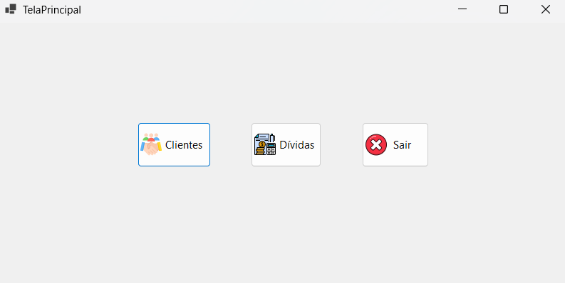
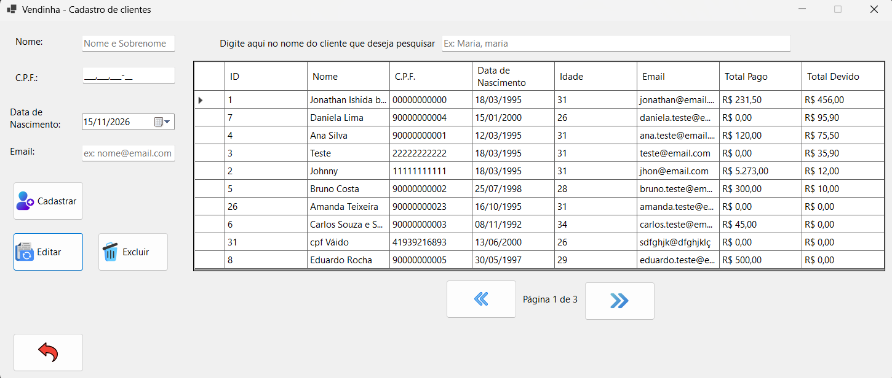
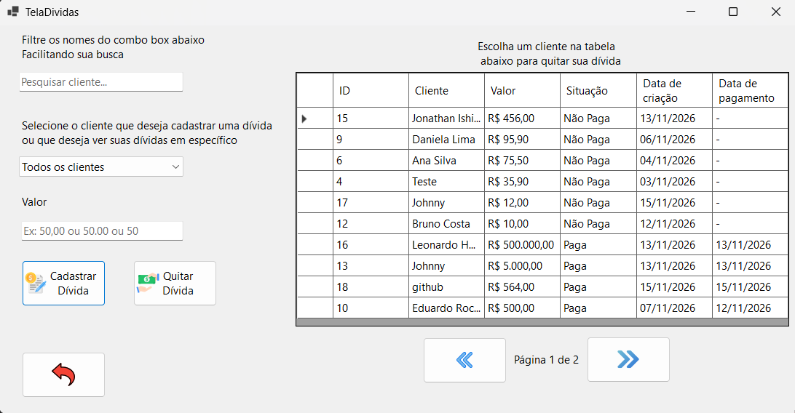
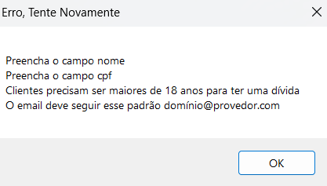
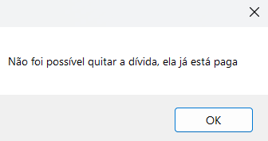
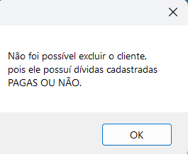

# 🛒 Vendinha
Sistema de Gerenciamento de clientes e dívidas desenvolvido como projeto final da disciplina de Plataforma de desenvolvimento de sistemas, ministrada pelo Professor Rodrigo Rodrigues.

## 📋 Sobre o projeto
Gerenciar clientes e suas dívidas por meio de um sistema de interface gráfica.

## 🚀 Funcionalidades

### 👤 Gerenciamento de clientes
- Cadastrar novos clientes.

- Consultar clientes cadastrados.

- Editar informações dos clientes.

- Excluir clientes que não possuem dívidas.

- Pesquisar clientes.

- Paginação de registros, exibindo até 10 registros por página.

- Validar os dados informados.

### 💰 Gerenciamento de dívidas
- Cadastrar dívidas de clientes.

- Consultar dívidas cadastradas.

- Registrar o pagamento de dívidas.

- Armazenar a data de criação e de pagamento.

- Impedir que um cliente possua mais de uma dívida ativa.

## 🛠️ Tecnologias utilizadas
-  — Linguagem de programação.
-  — Plataforma de desenvolvimento.
-   — Interface gráfica.
-  — ORM para acesso ao banco de dados.
-  — Banco de dados relacional.
-  — Provedor de conexão com PostgreSQL.
-   — Ambiente de desenvolvimento.
-  — Controle de versão.
-  — Hospedagem do repositório.

## 📁 Estrutura do projeto

## ⚙️ Configuração do ambiente
⚙️ Configuração do ambiente

1. Clone o repositório.

2. Abra a solução no Visual Studio.

3. Instale ou restaure os pacotes NuGet necessários.

4. Crie o banco de dados PostgreSQL chamado vendinha.

5. Execute o script SQL disponibilizado no repositório.
    - Os scripts foram separados em 3 arquivos, execute-os na sequência 1 a 1 para evitar erros no postgre

6. Configure o arquivo .env com a conexão do seu banco de dados.
    - Ex:VENDINHA_CONEXAO=Host=localhost;Port=5432;Database=vendinha;Username=postgres;Password=SUA_SENHA_AQUI

7. Compile e execute o projeto.

Observação: O arquivo .env NÂO FOI disponibilizado no repositório por questões de segurança. Cada usuário deverá criar seu próprio arquivo com as configurações locais. Veja o exemplo de conexão no ítem 6 acima trocando apenas a senha

## 🎓 Finalidade
Projeto desenvolvido com fins acadêmicos com o fim de aplicar os conceitos aprendidos na disciplina de Plataforma de Desenvolvimento de sistemas como:
- Poogramação Orientada a objetos
- CRUD
- Validação de Dados
- ORM
- Integração entre a linguagem C# e PostgreSQL
- Desenvolvimento de interfaces gráficas

## 📸 Capturas de tela

## 👨‍💻 Autor

**Jonathan Ishida Biazollo**

Bacharelado em Ciência da Computação — UNIMAR.